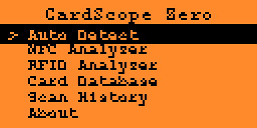
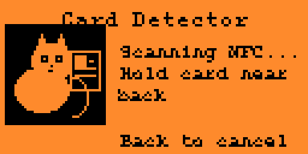
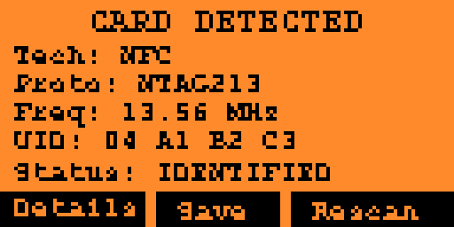
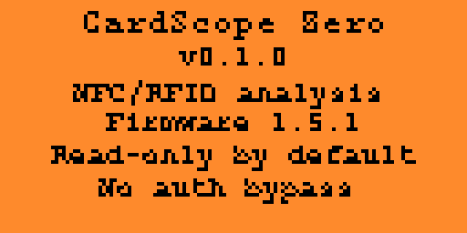

# CardScope Zero

Advanced NFC/RFID identification and analysis tool for Flipper Zero.

CardScope Zero is an external FAP. It does not modify stock firmware features.

## Features

- **Auto Detect** — sequential NFC → 125 kHz RFID scan
- **NFC Analyzer** — official `NfcScanner` / `NfcPoller` path
- **RFID Analyzer** — official `LFRFIDWorker` + `ProtocolDict`
- **Card Database** — capability matrix for firmware SDK 1.5.1
- **Scan History** — persistent FlipperFormat storage
- **Cat reading animation** — official `IconAnimation` asset during scan
- Read-only identification focus (no authentication bypass)

## Requirements

- Flipper Zero with **Official firmware 1.5.1** (or a compatible release API)
- [uFBT](https://github.com/flipperdevices/flipperzero-ufbt)
- microSD recommended for history persistence

## Architecture

Official Flipper UI pattern:

- `ViewDispatcher` + `SceneManager`
- `ADD_SCENE` config macros (same pattern as stock NFC / examples)
- GUI modules: `Submenu`, `Popup`, `Widget`, `TextBox`
- Custom scan view with `IconAnimation` (`A_CatReading_42x42`)

Analysis modules wrap SDK libraries only:

- `libnfc` — scanner, poller, device
- `liblfrfid` — worker + protocol dictionary

```text
card_scope_zero/
├── application.fam
├── cardscope_zero.c / .h
├── scenes/          # SceneManager screens
├── views/           # Custom scan view + cat animation
├── modules/         # Detector, NFC/RFID analyzers, history
├── database/        # Protocol capability matrix
└── images/          # FAP icon assets / animation frames
```

## Build

```bash
ufbt update --channel=release
cd /path/to/card_scope_zero
ufbt
```

Output FAP:

```text
dist/cardscope_zero.fap
```

## Install / launch

With Flipper connected over USB:

```bash
ufbt launch
```

Or copy `dist/cardscope_zero.fap` to `apps/NFC/` on the SD card.

## Usage

1. Open **CardScope Zero** from Applications → NFC
2. Choose **Auto Detect**, **NFC Analyzer**, or **RFID Analyzer**
3. Hold the card near the correct antenna (cat animation plays while scanning)
4. Review result → **Details** / **Save** / **Rescan**
5. Back cancels an active scan and stops radio workers

## Screenshots

Catalog screenshots (qFlipper format, 512×256):

| Preview | Screen |
|---|---|
|  | Main menu |
|  | Card Detector + cat animation |
|  | Card detected |
|  | About |

## Documentation

- [PROTOCOL_SUPPORT.md](PROTOCOL_SUPPORT.md) — supported protocols and capability matrix
- [TESTING.md](TESTING.md) — build checks and hardware validation status
- [changelog.md](changelog.md) — version history (Apps Catalog format)
- [CATALOG.md](CATALOG.md) — Flipper Apps Catalog readiness checklist

## Flipper Apps Catalog

This repository is prepared for submission to the official Flipper Apps Catalog (`applications/NFC/cardscope_zero`). See [CATALOG.md](CATALOG.md) and the draft [`catalog/manifest.yml`](catalog/manifest.yml).

## Limitations

- Write/emulate are documented in the matrix but not implemented in v0.1
- Protected memory is reported, never forced open
- Antennas are never used concurrently (NFC then LF RFID in Auto mode)
- Some on-device cases remain pending hardware validation

## License

Project files in this repository. Flipper Zero SDK remains under Flipper Devices licensing.
